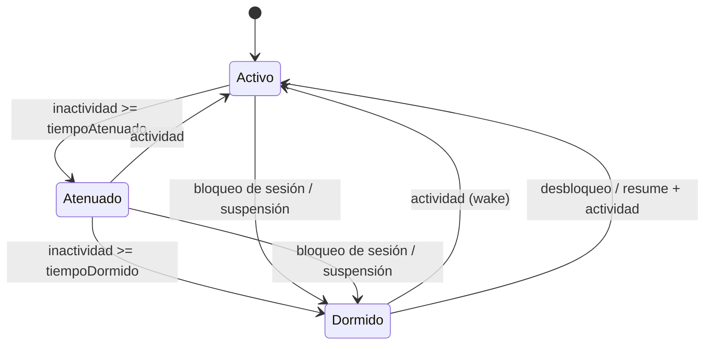

# Plan de arquitectura y especificación técnica: Stream Deck Plus, Neo y reposo de docks (v0.15)

Ítem 115 del roadmap (compatibilidad física con otros docks). Documento de **diseño**: no hay código nuevo todavía.

- Base: [`auditoria-opendeck.md`](./auditoria-opendeck.md) §1.3-1.5, §3.1.4, §3.1.6 y recomendaciones R1, R3, R4 y R6.
- Fecha: 2026-10-09.
- Estado del hardware: **no hay un Plus ni un Neo en mano**. Se aplica la regla vigente «sin hardware, sin verificar»: los modelos nacen con `verificado: false` y la UI lo indica, igual que los Mirabox no probados.

> [!IMPORTANT]
> **Licencia.** OpenDeck es GPL-3.0. Se usó solo para saber *qué* soportar y *cómo se comporta*. Nada de su código se porta ni se transcribe. El protocolo se implementa desde fuentes MIT: `@elgato-stream-deck/node` de Julusian y `python-elgato-streamdeck`, además de las capturas de tráfico propias cuando haya hardware. Hay que añadir la atribución en `THIRD_PARTY_NOTICES.md`, como ya se hizo con el módulo Mirabox de Bitfocus.

> [!WARNING]
> **Datos de protocolo por contrastar.** Los offsets de informes, los números de comando y las rotaciones de imagen de las secciones 3 y 4 son la referencia de trabajo según las librerías públicas. El autor no ha podido releerlas ni ejecutarlas al escribir esto. Cada uno está marcado **[V]** («verificar») y debe contrastarse con la fuente MIT y con un dispositivo real antes de pasar a `verificado: true`.

---

## 1. Alcance

| Incluido | Fuera de alcance |
|---|---|
| Stream Deck Plus (`0x0fd9:0x0084`) | Plus XL (`0x00c6`), Pedal (`0x0086`) y el resto de la familia Elgato (se dejan listos para añadirse por tabla) |
| Stream Deck Neo (`0x0fd9:0x009a`) | Plugins de Elgato / host OpenAction (ítems 60, 83, 105c) |
| Sistema de reposo/sueño por inactividad (todos los docks, también el N3 Mirabox) | Dispositivos virtuales por plugin (R4) |
| Extensión del modelo de superficies para controles nuevos | Háptica |

### 1.1 Capacidades objetivo

| | Plus | Neo |
|---|---|---|
| Teclas LCD | 8 (2×4), **120×120 px** | 8 (2×4), 96×96 px **[V]** |
| Diales | 4, pulsables y giratorios | no |
| Pantalla adicional | **Tira LCD táctil 800×100** | **Infobar 248×58**, solo salida |
| Controles extra | los diales y la tira | **2 touchpoints** capacitivos con LED RGB |
| Formato de imagen | JPEG | JPEG |
| Interfaz HID de control | `interface 0` **[V]** | `interface 0` **[V]** |

---

## 2. Estado actual y hueco

El código existente (`electron/main/superficies/`) está atado a Mirabox de tres maneras:

1. `gestor.ts` crea siempre `DispositivoMirabox` y usa `interpretarEntrada` de `protocoloMirabox`.
2. `modelos/tipos.ts` tipa los modelos como `ModeloMirabox` (`packetSize`, códigos de byte 9).
3. `ControlSuperficie` ya tiene `key | button | knob | swipe`. Faltan **touchpoint**, **tira LCD** (con salida de imagen) e **infobar**.

Piezas reutilizables sin cambios: sondeo por `devicesAsync()` cada 3 s, identificación por número de serie, retirada tolerante a errores, `InfoSuperficie`, `DisposicionSuperficie` y el flujo `alEntrada`/`alCambio` hacia el renderer.

---

## 3. Arquitectura propuesta

### 3.1 Abstracción de driver

Se separa **qué hace un dispositivo** de **cómo habla su protocolo**.

```ts
// superficies/driver.ts: contrato común
interface DriverSuperficie {
  readonly estaVivo: boolean;
  imagen(control: ControlRef, jpeg: Buffer): Promise<void>;   // tecla, tira o infobar
  brillo(valor: number): Promise<void>;                        // 0-100
  limpiar(): Promise<void>;
  ledTouchpoint?(indice: number, rgb: [number, number, number]): Promise<void>; // solo Neo
  cerrar(): Promise<void>;
}

interface FamiliaSuperficie {
  id: 'mirabox' | 'elgato';
  buscar(vid: number, pid: number): ModeloSuperficie | undefined;
  abrir(serial: string, modelo: ModeloSuperficie, path: string, cbs: CallbacksDispositivo): Promise<DriverSuperficie>;
  interpretarEntrada(buf: Buffer, modelo: ModeloSuperficie): EntradaSuperficie[] | null;
}
```

Nota: `interpretarEntrada` pasa a devolver una **lista**. Un informe Elgato de teclas puede traer varios cambios a la vez, mientras que un informe Mirabox trae uno.

`gestor.ts` pasa a recorrer un registro de familias. El primer `buscar(vid, pid)` que acierte decide la familia. El sondeo, la serie y la retirada no cambian.

### 3.2 Estructura de ficheros

```
electron/main/superficies/
├── gestor.ts                    ← se generaliza (familias + reposo)
├── driver.ts                    ← NUEVO: interfaces
├── reposo.ts                    ← NUEVO: máquina de estados de inactividad (sección 5)
├── mirabox/                     ← mover dispositivoMirabox.ts, protocoloMirabox.ts, modelos/
└── elgato/                      ← NUEVO
    ├── modelos.ts               ← tabla Plus/Neo (+ futuros)
    ├── protocoloElgato.ts       ← puro: construcción de paquetes y parseo (testeable sin HID)
    └── dispositivoElgato.ts     ← E/S HID, cola de escritura, ciclo de vida
```

Mover Mirabox a su carpeta es opcional y se hace en un commit aparte, solo mecánico. Si el riesgo de conflictos es alto, `elgato/` puede convivir junto a los ficheros actuales.

### 3.3 Extensión de tipos (`src/types`)

| Cambio | Detalle |
|---|---|
| `ControlSuperficie` | + `'touchpoint'`, `'strip'`, `'infobar'` (`knob` se reutiliza para los diales; `key` para las teclas) |
| `GestoSuperficie` | + `'tap'`, `'long'`, `'drag'` (tira) además de `down`, `izq`, `der` |
| `LcdControl` | ya describe tamaño y giro por tecla; se usa también en `strip` e `infobar` |
| Entrada de la tira | `EntradaSuperficie` gana `zona?: number` (0-3) y `x?`, `y?` opcionales |
| `ModeloSuperficie` | `ModeloMirabox` se generaliza: lo propio de Mirabox (`packetSize`, `entradas` por byte 9) pasa a un campo `protocolo` de la familia |

El renderer sigue consumiendo `DisposicionSuperficie` (lista de controles con fila/columna). No necesita saber nada de HID.

> [!NOTE]
> Hay que revisar `check-ipc.mjs` y `check-i18n.mjs`: cualquier canal o texto de UI nuevo debe quedar cubierto (nombres de control, aviso «sin verificar», ajustes de reposo).

### 3.4 Mapa de controles por modelo

**Plus** (orden de huecos de la página: teclas, luego diales, luego tira):

| Control | Cantidad | Entradas |
|---|---|---|
| `key` 0-7 | 8 | `down`, `up` |
| `knob` 0-3 | 4 | pulsar (`down`/`up`), giro `izq`/`der` con **ticks con signo** |
| `strip` 0 | 1 (4 zonas de 200 px alineadas con los diales) | `tap`, `long`, `drag` |

**Neo**:

| Control | Cantidad | Entradas |
|---|---|---|
| `key` 0-7 | 8 | `down`, `up` |
| `touchpoint` 0-1 | 2 | `down`, `up` (en el protocolo aparecen como teclas 8 y 9 **[V]**) |
| `infobar` 0 | 1 | solo salida de imagen/texto |

---

## 4. Especificación de protocolo

Ambos usan el **protocolo Elgato de segunda generación** por HID (informes de salida de 1024 bytes). Son distintos del protocolo Mirabox (`CRT`/`CLE`), así que no se comparte código de paquetes.

### 4.1 Identificación

| Dato | Plus | Neo |
|---|---|---|
| VID / PID | `0x0fd9` / `0x0084` | `0x0fd9` / `0x009a` |
| Serie | `serialNumber` HID (se mantiene como clave, igual que ahora) | idem |
| Interfaz | `interface 0` **[V]** | idem |

El gestor ya descarta interfaces que no son la de control; se reutiliza esa lógica con `interfazControl` por modelo.

### 4.2 Salida

Todo en informes de salida de 1024 bytes (relleno con ceros), troceando el JPEG en páginas.

**Imagen de tecla [V]**

```
byte 0     0x02
byte 1     0x07
byte 2     índice de tecla (0-based)
byte 3     1 si es la última página, si no 0
bytes 4-5  longitud del payload de esta página (uint16 LE)
bytes 6-7  número de página (uint16 LE)
bytes 8..  payload JPEG (hasta 1016 bytes)
```

**Imagen de la tira LCD del Plus [V]**

```
byte 0     0x02
byte 1     0x0c
bytes 2-3  x   (uint16 LE)     bytes 4-5  y    (uint16 LE)
bytes 6-7  ancho (uint16 LE)   bytes 8-9  alto (uint16 LE)
byte 10    1 si es la última página
bytes 11-12 número de página   bytes 13-14 longitud del payload
byte 15    0x00
bytes 16.. payload JPEG (hasta 1008 bytes)
```

Se admite escribir **ventanas parciales** (p. ej. 200×100 por zona/dial) para no reenviar los 800×100 completos al cambiar un solo dial.

**Infobar del Neo [V]**: JPEG 248×58 por la ruta de pantalla propia del Neo. El comando exacto y la rotación (180° según OpenDeck) se confirman con la fuente MIT y con hardware. No se escribe una implementación hasta tener ese dato.

**Feature reports [V]**

| Operación | Informe |
|---|---|
| Brillo | `[0x03, 0x08, nivel 0-100]` |
| Reset a logo | `[0x03, 0x02]` |
| Versión de firmware | feature `0x05` (opcional, para el log) |
| LED de touchpoint (Neo) | por determinar en la fuente MIT |

### 4.3 Entrada [V]

Informe de entrada con `byte 0 = 0x01`; `byte 1` indica el tipo:

| `byte 1` | Tipo | Contenido |
|---|---|---|
| `0x00` | Teclas | estados 0/1 desde un offset fijo (`4`); se **compara con el estado anterior** y se emiten solo los cambios |
| `0x02` | Tira táctil (Plus) | `byte 4`: 1 = toque corto, 2 = largo, 3 = arrastre; x/y en uint16 LE (`6-7`, `8-9`); en arrastre, destino en `10-13` |
| `0x03` | Diales (Plus) | `byte 4`: 0 = pulsación (estados desde `5`), 1 = giro (**int8 con signo** por dial desde `5`) |

Reglas de traducción a `EntradaSuperficie`:

- **Teclas**: guardar `estadoPrevio[]` por dispositivo. Un `1` que antes era `0` genera `down`; el caso inverso genera `up`.
- **Diales**: el giro llega como delta en ticks. Se emite un `izq`/`der` por cada tick, sin perder los ticks de ráfagas rápidas, o bien un único evento con `ticks` si el consumidor lo admite. Se decide en la implementación, reutilizando la abstracción de perillas del N3 (R1).
- **Tira**: `x` se convierte en `zona = floor(x / 200)`. Un arrastre se reduce a `drag` con dirección (`izq`/`der`) cuando `|dx|` supera un umbral, de modo que sirve como *swipe*.
- **Neo**: el estado de las teclas trae `8 + 2` posiciones; los dos últimos se asignan a `touchpoint 0-1`.
- Un informe de longitud inesperada o con tipo desconocido se ignora y se registra a nivel `warn`, **sin lanzar excepción** (patrón actual: un error de HID nunca tumba el proceso).

### 4.4 Imágenes: pipeline del renderer

Hoy el renderer sube JPEG en base64 por tecla (`gestor.imagen(serial, tecla, jpegBase64)`).

| Destino | Tamaño | Rotación **[V]** | Calidad |
|---|---|---|---|
| Tecla Plus | 120×120 | 0° | JPEG q≈90 |
| Tecla Neo | 96×96 | 0° o 180° | JPEG q≈90 |
| Tira Plus | 800×100 (o ventana 200×100) | 0° | JPEG q≈90 |
| Infobar Neo | 248×58 | 180° | JPEG q≈90 |

La rotación/espejo es **responsabilidad del driver**, no del renderer: el renderer entrega la imagen en orientación natural y `LcdControl` indica tamaño y giro, exactamente como hace ya el modelo Mirabox. La API se amplía a `imagen(serial, control: {tipo, indice}, jpegBase64, ventana?)` para direccionar tecla, tira o infobar.

### 4.5 Escritura y robustez

- **Cola de escritura serializada por dispositivo** (una imagen a la vez). Las páginas de una imagen no deben intercalarse con las de otra.
- **Coalescencia**: si llega una imagen nueva del mismo control mientras la anterior espera en cola, se descarta la antigua. Importante en la tira, que se redibuja a menudo.
- **Tope de frecuencia** para la tira (≈10-15 fps máx.); no hay animación fluida y el USB sufre.
- Un `write` que falla tras N reintentos marca el dispositivo como retirado (flujo `desconectar` actual).
- **Conflicto con el software de Elgato.** Si la app oficial tiene el dispositivo abierto, la apertura puede fallar o los informes se pelean. Se documenta como incompatibilidad conocida («cierra Stream Deck app») y se muestra un aviso claro en el log/UI si `HIDAsync.open` falla.
- Linux: añadir reglas udev para estos PIDs (`0084`, `009a`) en la guía de instalación, con `MODE 0660 TAG uaccess`.

---

## 5. Sistema de reposo / sueño por inactividad

Cubre R6. Aplica a **todas** las familias (el N3 también), con la lógica en el gestor y no en cada driver.

### 5.1 Comportamiento

Máquina de estados por dispositivo:



| Estado | Acción sobre el dock |
|---|---|
| **Activo** | Brillo del usuario. |
| **Atenuado** *(opcional)* | Brillo al `porcentajeAtenuado` (p. ej. 15 %). |
| **Dormido** | Brillo 0 y, en el Neo, LEDs de touchpoint a negro. Las imágenes **no se borran** (no hay que redibujar al despertar). |

Despertar: se restaura el **brillo guardado del usuario**, no el brillo atenuado. En el Plus/Neo, el brillo cubre también la tira y la infobar.

### 5.2 Fuentes de actividad

- Cualquier **entrada del propio dock** (tecla, dial, tira, touchpoint).
- Cambio de página/perfil iniciado desde la app, el móvil o un disparador, **sí cuenta** como actividad (el dock se está usando).
- Los ticks del reloj o los widgets en vivo **no** cuentan: si el dock se duerme, los redibujos siguen pero con brillo 0, sin despertarlo.

### 5.3 Primera pulsación al despertar

El primer evento que despierta un dock dormido **se consume y no ejecuta la acción** (evita pulsaciones accidentales, igual que hace OpenDeck). Si ya estaba solo atenuado, la pulsación **sí** se ejecuta. Es una opción de usuario («Despertar sin ejecutar»), activa por defecto.

### 5.4 Eventos del sistema

Se usa `powerMonitor` de Electron en el main:

| Evento | Acción |
|---|---|
| `lock-screen` | todos los docks → Dormido |
| `unlock-screen` | wake de todos los docks (se restaura brillo) |
| `suspend` | Dormido, sin escribir al bus si el dock ya no responde |
| `resume` | volver a enumerar de inmediato (sin esperar los 3 s del sondeo) y restaurar brillo |

Tras `resume` los docks pueden haberse reenumerado: se confía en el flujo de retirada/alta del gestor y el reposo se reevalúa al reabrir.

### 5.5 Ajustes

Nuevo bloque en la configuración (con migración versionada, como el resto):

```ts
interface AjustesReposo {
  activo: boolean;               // por defecto true
  atenuarTrasMin: number;        // 0 = no atenuar; por defecto 0
  dormirTrasMin: number;         // por defecto 10; 0 = nunca
  porcentajeAtenuado: number;    // por defecto 15
  dormirAlBloquear: boolean;     // por defecto true
  despertarSinEjecutar: boolean; // por defecto true
}
```

Ajustes globales con *override* opcional por dispositivo (clave `serial`). Texto de UI i18n ES/EN en la sección de dispositivos.

### 5.6 Implementación

- `reposo.ts` expone `registrarActividad(serial)`, `iniciar(gestor)` y `detener()`. No importa nada de HID.
- **Un único temporizador** (tic de ~5-10 s) que compara `ahora - ultimaActividad[serial]`, en vez de un temporizador por dispositivo. La resolución de segundos es suficiente.
- `gestor.alEntradaCruda` llama a `registrarActividad` y, si el dock estaba dormido, aplica la regla 5.3 antes de repartir la entrada.
- El brillo del usuario se guarda aparte del brillo efectivo: `brilloUsuario[serial]` frente a lo que se escribió al dock.
- El gestor expone `estadoReposo(serial)` para que la UI muestre «Dormido / Atenuado».

---

## 6. Plan de implementación por fases

| Fase | Contenido | Hardware | Criterio de salida |
|---|---|---|---|
| **0** | Extraer interfaz `DriverSuperficie`/`FamiliaSuperficie`; Mirabox pasa a ser la primera familia sin cambio de comportamiento | No | `npm run check` verde; el N3 sigue funcionando igual |
| **1** | `reposo.ts` + ajustes + UI + `powerMonitor`, probado con el **N3 que sí hay** | N3 | Atenuar/dormir/despertar OK; primera pulsación consumida; bloqueo de sesión |
| **2** | `protocoloElgato.ts` puro + tests unitarios con **informes sintéticos** (construcción de páginas, parseo de teclas/diales/tira) | No | Tests verdes; offsets **[V]** anotados como pendientes |
| **3** | `dispositivoElgato.ts`, `modelos.ts` Plus/Neo (`verificado: false`), pipeline de imagen con rotación en el driver, extensión de tipos y UI de controles nuevos | No | Compila, aparece la disposición correcta de los modelos en la UI |
| **4** | Verificación con **Plus real**: teclas, diales, tira, brillo, reposo. Contrastar cada **[V]** | Plus | Marcar `verificado: true` solo el Plus |
| **5** | Verificación con **Neo real**: touchpoints (LED), infobar | Neo | Marcar `verificado: true` solo el Neo |
| **6** | Dial stacks sobre las perillas (R3), usando el Plus como primer consumidor | Plus/N3 | Fuera del alcance de este ítem; solo se deja el gancho |

Las fases 0-3 se pueden cerrar sin hardware. 4 y 5 dependen de tener los aparatos. Una entrega parcial es válida: Plus y Neo salen como «experimental / no verificado» hasta pasar sus fases.

---

## 7. Pruebas

- **Unitarias** (sin HID): paginación de imagen (último paquete, longitudes, número de página), parseo de informes de teclas/diales/tira con vectores sintéticos, diff de estado de teclas, signo de los ticks, máquina de estados de reposo con reloj simulado (inyectar `ahora`).
- **Guardianes de `npm run check`**: i18n (textos nuevos), ipc (canales nuevos), dependencias (`depcruise`: `reposo.ts` no depende de drivers; el renderer no importa `electron/`).
- **Manual con hardware**: lista de comprobación por modelo (cada tecla/dial/zona de tira; brillo 0-100; reposo; desconectar y reconectar en caliente; apps de Elgato abierta y cerrada).

---

## 8. Riesgos y decisiones abiertas

| Riesgo | Mitigación |
|---|---|
| Offsets/comandos **[V]** incorrectos | Fase 2 con tests basados en la fuente MIT; fase 4-5 con hardware; modelos marcados `verificado: false` |
| La app oficial de Elgato acapara el HID | Aviso en UI y documentación; no se intenta matar su proceso |
| Redibujo de la tira satura el USB | Coalescencia, ventanas parciales y tope de fps |
| Cambiar `interpretarEntrada` a lista rompe el N3 | Fase 0 sin cambio de comportamiento, con los tests actuales como red |
| `suspend`/`resume` con reenumeración | Reenumerar al `resume`; no depender del estado previo |
| Neo: infobar y LED sin fuente verificada | Se difieren a fase 5; no se escribe código a ciegas |

**Decisiones que necesita el dueño:**

1. ¿La tira del Plus será solo *swipe* (como la `swipe` del N3) o también mostrará contenido por dial (valor, nombre, icono)? La spec lo permite, pero implica diseño de UI.
2. ¿Los ajustes de reposo son globales o por dispositivo desde el primer día? La spec propone global con *override* opcional.
3. ¿Se acepta mover `mirabox/` a su carpeta (fase 0) o se prefiere convivir con los ficheros actuales para reducir el diff?
4. ¿Se prioriza la fase 1 (reposo para el N3, sin hardware nuevo) como entrega independiente? Se recomienda que sí: aporta valor inmediato.

---

## 9. Fuentes

- `docs/investigacion/auditoria-opendeck.md` (hardware, formatos de imagen, reposo).
- Código actual: `electron/main/superficies/{gestor,dispositivoMirabox,protocoloMirabox}.ts` y `modelos/tipos.ts`.
- A consultar en la implementación (MIT): `@elgato-stream-deck/node` (Julusian / Bitfocus) y `python-elgato-streamdeck`.
